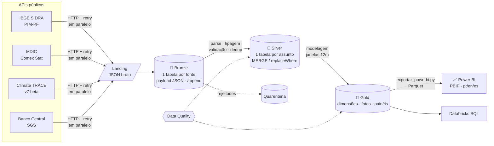

<p align="center"></p>

# 🏭 Siderurgia Brasil Lakehouse

[](https://github.com/DeividJesusMartins/siderurgia-brasil-lakehouse/actions/workflows/ci.yml)


Projeto de engenharia de dados ponta a ponta sobre a **siderurgia brasileira**, da coleta em APIs públicas até um dashboard no Power BI. Ele integra **quatro APIs** com formatos diferentes:
- produção industrial do **IBGE**;
- exportações de aço do **MDIC**;
- emissões de gases de efeito estufa por usina do **Climate TRACE**;
- câmbio do **Banco Central**.

Os dados passam por uma **arquitetura medalhão (bronze → silver → gold)** com **PySpark + Delta Lake**, saem num modelo dimensional e alimentam um **dashboard Power BI em PBIP**, com 4 páginas e tradução **pt / en / es**.

O mesmo código roda **na sua máquina** (Delta por caminho) e **no Databricks** (Unity Catalog + Jobs serverless). O projeto inclui testes automatizados, CI/CD e infraestrutura como código, e já foi executado de ponta a ponta com os dados reais das quatro APIs.

> Todos os dados são **públicos e oficiais**. Nenhum dado interno de empresa é usado.

---

## 🎯 Perguntas de negócio

1. **Como evolui a produção da metalurgia** em relação ao restante da indústria de transformação?
2. **O câmbio puxa as exportações de aço?** O que acontece com volume e preço por tonelada quando o dólar sobe?
3. **Quem são os maiores emissores do setor** e quão concentradas estão as emissões entre as usinas?

## 🏗️ Arquitetura



**Job no Databricks:** as 4 ingestões rodam em paralelo, então uma API lenta não atrasa as outras. Cada silver depende só da sua bronze, e a gold espera todas.

| Camada | Estratégia | Por quê |
|---|---|---|
| Landing | arquivo JSON por fonte/lote | Reprocessar sem chamar as APIs de novo |
| Bronze | `append`, schema único (`payload` JSON + linhagem) | *Schema-on-read*: se uma API mudar o formato, a ingestão não quebra |
| Silver — IBGE, Climate TRACE, BCB | `MERGE` idempotente | Absorve revisões sem duplicar; só reescreve linhas que mudaram |
| Silver — Comex Stat | `replaceWhere` do período | A fonte devolve o ano consolidado; linhas que sumiram da fonte também somem |
| Gold | `overwrite` | Volume pequeno; métricas de 12 meses dependem do histórico |

Detalhes de cada tabela e coluna em [`docs/modelo_de_dados.md`](docs/modelo_de_dados.md).

## ⚙️ O que o projeto demonstra

**Ingestão de fontes heterogêneas**
- Quatro estilos de API:
  - **SIDRA**: parâmetros no caminho da URL e resposta com uma linha de cabeçalho.
  - **Comex Stat**: consulta via `POST` com corpo JSON, resposta no envelope `data.list` e **limite de requisições** (HTTP 429).
  - **Climate TRACE**: paginação por `limit`/`offset`, filtrada por país (`gadmId=BRA`) e subsetor `iron-and-steel`.
  - **BCB**: séries diárias recusam janelas acima de 10 anos, então a consulta é feita de 5 em 5 anos.
- Um contrato único (`Fonte.extrair`) faz o pipeline tratar as quatro do mesmo jeito.
- Cliente HTTP compartilhado com *retry* e *backoff* exponencial para 429/5xx. No 429, ele espera o tempo que a própria API pede (cabeçalho `Retry-After` ou a mensagem "tente novamente em N segundos") e espaça as chamadas para não chegar ao limite.
- O Comex Stat é consultado em **blocos de vários anos por requisição**, o que reduz muito o número de chamadas na carga histórica.
- **Carga incremental por marca d'água** com janela de reprocessamento específica de cada fonte. As fontes revisam dados já publicados: o IBGE revisa a PIM-PF e o MDIC consolida os meses recentes.
- **Isolamento de falhas**: se uma API cair, as outras são ingeridas e o erro é reportado no fim.

**Transformação e modelagem**
- Bronze *schema-on-read* e silver tolerante a variações de nome de campo. Um layout desconhecido vai para a **quarentena** com o motivo, sem derrubar o job.
- `try_cast` e `try_to_timestamp` são seguros com ANSI ligado, que é o padrão no Spark 4 e no Databricks recente. Eles tratam os símbolos do IBGE (`..`, `X`).
- Variação de 12 meses com `rangeBetween` sobre um índice de mês. Ela continua correta mesmo com meses faltantes, algo que `lag` e `rowsBetween` não garantem.
- Janelas **particionadas** (por atividade, por ano) contra janelas globais, com o custo de cada uma comentado no código.
- *Broadcast joins* para dimensões pequenas e "pivot manual" com agregação condicional.

**Qualidade e confiabilidade**
- Checagens de *data quality* entre camadas: não nulo, unicidade e faixas de sanidade. Severidade `erro` bloqueia a publicação; `alerta` só registra.
- 42 testes:
  - clientes HTTP simulados, incluindo a espera pedida pela API no 429;
  - parsing de cada fonte;
  - modelagem;
  - fluxo ponta a ponta com carga incremental, revisão de dados e falha de uma fonte;
  - integração com Delta real (MERGE, replaceWhere e Time Travel).

**Operação (DataOps)**
- **Databricks Asset Bundle**: DAG de 9 tasks em serverless, com retry por fonte, alerta por e-mail e job semanal de `OPTIMIZE ZORDER` + `VACUUM`.
- **Unity Catalog**: catálogos por ambiente (`_dev` / prod), schemas por camada, Volume para a landing e `GRANT` por grupo.
- **CI** (GitHub Actions): ruff, pytest, testes Delta e build do wheel. **CD**: `bundle deploy -t prod` depois que a CI passa na `main`.

**Consumo (BI)**
- Dashboard **Power BI em PBIP**: modelo em TMDL e relatório em PBIR, tudo em texto e versionado neste repositório.
- Modelo estrela sobre a gold, medidas DAX organizadas em pastas e KPIs de 12 meses que terminam no último mês com dado.
- **Tradução pt / en / es** dirigida por tabelas, medidas e parâmetros de campo, no mesmo padrão usado em relatórios corporativos multilíngues.

## 📈 Dashboard Power BI

Relatório com 4 páginas sobre a camada gold:

| Página | O que responde |
|---|---|
| **Visão Geral** | Como estão produção, exportações, preço e emissões agora? KPIs com variação, produção × indústria, exportações × dólar, top destinos, produtos e emissoras. |
| **Produção** | A metalurgia acompanha o restante da indústria? Séries dessazonalizadas, média móvel de 3 meses e ranking de variação por atividade. |
| **Exportações** | O câmbio puxa as exportações? Volume, receita FOB e preço em 12 meses, concentração dos 5 maiores destinos e top 10 destinos e produtos (SH4). |
| **Emissões** | Quanto o setor emite e quão concentrado é? Total anual, participação das 3 maiores usinas e ranking com 🏆 para as 5 maiores e ⚠️ para as 5 menores emissoras. |

Recursos do relatório:
- **Seletor de idioma pt / en / es**, sincronizado entre as páginas: títulos, KPIs, legendas, cabeçalhos de tabela, filtros e frases dinâmicas ("▲ 3,5% vs 12 meses anteriores") mudam de idioma, e datas e percentuais seguem a cultura escolhida.
- **Navegação em pílulas** no cabeçalho e **filtros por página** (ano, mês, país, produto, atividade, usina).
- Identidade visual própria: tema com a paleta do aço (grafite, laranja incandescente, azul-aço) e logo original do projeto.

Para abrir:

```bash
python scripts/exportar_powerbi.py   # gera os .parquet da gold em ./exports
```

Depois, abra `powerbi/SiderurgiaBrasil.pbip` no Power BI Desktop, aponte o parâmetro `PastaDados` para a pasta dos `.parquet` (**Transformar dados → Gerenciar parâmetros**) e clique em **Atualizar**. Detalhes do modelo, das medidas e da tradução em [`docs/dashboard.md`](docs/dashboard.md).

## 📁 Estrutura

```
siderurgia-brasil-lakehouse/
├── src/siderurgia_lakehouse/
│   ├── config.py              # parâmetros das fontes e do ambiente
│   ├── spark.py               # SparkSession local (Delta) ou Databricks
│   ├── lakehouse.py           # leitura/escrita/MERGE/replaceWhere: local ou Unity Catalog
│   ├── ingestion/
│   │   ├── http.py            # cliente HTTP com retry, backoff e respeito ao 429
│   │   ├── fontes.py          # SIDRA, Comex Stat, Climate TRACE, BCB
│   │   ├── janelas.py         # quebra de períodos longos
│   │   └── landing.py         # persistência do JSON bruto
│   ├── transform/
│   │   ├── bronze.py          # schema único com payload + linhagem
│   │   ├── silver.py          # parsing, validação, quarentena, deduplicação
│   │   └── gold.py            # dimensões, fatos e painéis
│   ├── quality.py             # checagens de data quality
│   ├── pipeline.py            # orquestração das camadas
│   └── main.py                # CLI (entry point do wheel)
├── tests/                     # pytest: unitários, fluxo, integração Delta
├── scripts/exportar_powerbi.py # exporta a gold em Parquet para o Power BI
├── powerbi/                   # dashboard Power BI (PBIP)
│   ├── SiderurgiaBrasil.pbip
│   ├── SiderurgiaBrasil.SemanticModel/   # modelo em TMDL (tabelas, medidas, tradução)
│   └── SiderurgiaBrasil.Report/          # relatório em PBIR (páginas, visuais, tema, logo)
├── resources/jobs.yml         # Jobs do Databricks (DAG)
├── databricks.yml             # Asset Bundle (targets dev/prod)
├── sql/                       # setup do Unity Catalog + consultas analíticas
├── docs/
│   ├── modelo_de_dados.md     # dicionário de dados
│   ├── dashboard.md           # guia do dashboard
│   └── img/                   # logo do projeto
├── .github/workflows/         # CI e deploy
└── Makefile
```

## 🚀 Como executar

### Localmente

Pré-requisitos: **Python 3.10 a 3.12** (o PySpark 3.5 ainda não suporta versões mais novas) e **Java 17** (o Spark roda na JVM).

```bash
git clone https://github.com/DeividJesusMartins/siderurgia-brasil-lakehouse.git
cd siderurgia-brasil-lakehouse
python -m venv .venv && source .venv/bin/activate   # Windows: .venv\Scripts\activate
make install          # ou: pip install -e ".[dev,spark]"

make test             # testes rápidos (sem rede, sem Delta)
make test-delta       # integração com Delta Lake (baixa os JARs na 1ª vez)
make run              # pipeline completo → ./lakehouse/{landing,bronze,silver,gold}
```

A primeira execução baixa o histórico desde 2015 e leva alguns minutos, porque o Comex Stat limita a frequência de chamadas. As execuções seguintes são incrementais.

```bash
python -m siderurgia_lakehouse --camada bronze --fontes sidra_pimpf,bcb_cambio
python -m siderurgia_lakehouse --camada todas --full-refresh
make fonte F=comexstat_exportacoes        # bronze + silver de uma fonte só
python -m siderurgia_lakehouse --help
```

> **Sem Linux ou WSL?** O projeto também roda num **GitHub Codespace**. Se a imagem vier com um Python mais novo, crie o ambiente com `uv venv --python 3.11`.

### No Databricks

```bash
# 1. Uma vez: crie os catálogos (sql/00_setup_unity_catalog.sql) e ajuste o host em databricks.yml
databricks auth login --host https://SEU-WORKSPACE.cloud.databricks.com

# 2. Publique e rode
databricks bundle deploy -t dev
databricks bundle run siderurgia_lakehouse_diario -t dev
```

Depois, explore com as consultas de [`sql/01_consultas_gold.sql`](sql/01_consultas_gold.sql) ou conecte o Power BI no SQL Warehouse em `siderurgia_lakehouse.gold`.

## 📊 Fontes

| Fonte | Endpoint | Recorte |
|---|---|---|
| [IBGE — PIM-PF](https://sidra.ibge.gov.br/tabela/8888) | `apisidra.ibge.gov.br/values/t/8888/...` | Índices de produção por atividade (base 2022=100), desde 2015 |
| [MDIC — Comex Stat](https://comexstat.mdic.gov.br) | `POST api-comexstat.mdic.gov.br/general` | Exportações do capítulo 72 (ferro e aço) por país e SH4, desde 2015 |
| [Climate TRACE](https://climatetrace.org/data) | `GET api.climatetrace.org/v7/sources` | Usinas de ferro e aço no Brasil, t CO₂e/ano, desde 2021 |
| [Banco Central — SGS](https://www3.bcb.gov.br/sgspub) | `api.bcb.gov.br/dados/serie/bcdata.sgs.1/dados` | Dólar PTAX venda, diário |

**Pontos de atenção conhecidos.** O código já se protege contra eles:
- **Comex Stat**: a API limita a frequência de requisições e responde 429 com o tempo de espera na mensagem. O cliente respeita esse tempo, espaça as chamadas e agrupa vários anos por consulta. A documentação (`/docs`) também não descreve o formato da resposta, então a silver aceita os nomes de campo conhecidos (`metricFOB`/`vlFob`, `monthNumber`/`coMes`...); algo diferente vai para a quarentena com `layout_inesperado`.
- **Climate TRACE**: a API v7 é *beta*, pede uso moderado e só tem dados por usina a partir de 2021. A ingestão é sequencial, filtra por `gadmId=BRA` e tem limite de páginas; a silver confirma país e subsetor caso a API ignore algum parâmetro. Sem essa fonte, a gold é publicada mesmo assim, só sem as tabelas de emissões.

## ✅ Execução com dados reais

O pipeline completo já rodou contra as quatro APIs e publicou as **7 tabelas da gold**, com o *data quality* aprovado. Os alertas registrados mostram que as checagens funcionam como esperado:
- valores marcados como indisponíveis pelo IBGE (`..`, `X`), tratados como nulos e contabilizados;
- preços por tonelada fora da faixa típica em **ferroligas**, produto de valor unitário bem acima do aço comum;
- um mês recente ainda sem divulgação do IBGE, coberto pela janela de reprocessamento na próxima carga.

## 🧠 Decisões de projeto

- **Por que bronze com `payload` JSON em vez de colunas?** São quatro APIs fora do meu controle. Com o JSON bruto, uma mudança de layout nunca quebra a ingestão. O problema aparece de forma controlada na silver, que pode ser corrigida e reprocessada a partir da bronze.
- **Por que MERGE em umas fontes e replaceWhere em outra?** IBGE, Climate TRACE e BCB revisam *valores* de chaves que continuam existindo, e o MERGE resolve isso. O Comex Stat devolve o *período inteiro* consolidado, e uma combinação país/produto pode desaparecer depois da consolidação. Só substituindo o intervalo essa linha some da silver.
- **Por que identificar a metalurgia pelo nome, não pelo código?** O IBGE já renumerou as tabelas da PIM-PF (a 8159 virou a 8888 em 2023). Nomes de atividade da CNAE são mais estáveis que códigos internos de categoria.
- **Por que não particionar as tabelas?** Com dezenas de milhares de linhas, partições gerariam arquivos minúsculos. A manutenção semanal usa `ZORDER`. Em volume maior, o caminho seria *Liquid Clustering*.
- **Por que PySpark para esse volume?** Para demonstrar o padrão que escala. O mesmo código processaria milhões de linhas sem mudar a arquitetura.
- **Por que PBIP no Power BI?** O relatório vira texto (TMDL para o modelo, PBIR com um JSON por visual). Assim ele é versionado no Git, revisado em *diff* e evolui junto com o pipeline, em vez de ser um `.pbix` binário.
- **Por que tradução por tabelas e medidas?** Um único relatório atende pt, en e es. Os textos ficam numa tabela (`Tradução Textos`) e os rótulos de séries e colunas em parâmetros de campo; incluir um idioma é acrescentar linhas, sem duplicar páginas.

## 👤 Autor

**Deivid Martins** — Analista de Dados com foco em Engenharia de Dados (Databricks, PySpark, SQL, Power BI), atuando em projetos de dados para o setor siderúrgico.
[LinkedIn](https://www.linkedin.com/in/deividmartins) · [GitHub](https://github.com/DeividJesusMartins)

Licença [MIT](LICENSE).
