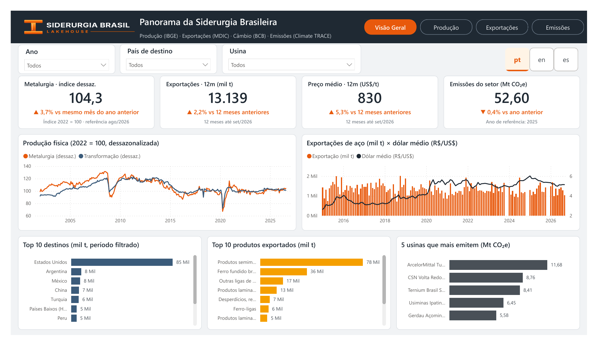

# 🏭 Siderurgia Brasil Lakehouse — Medallion Architecture com PySpark, Delta Lake e Power BI

[](https://github.com/DeividJesusMartins/siderurgia-brasil-lakehouse/actions/workflows/ci.yml)


Plataforma de engenharia de dados ponta a ponta sobre a **siderurgia brasileira**: produção, exportações de aço, câmbio e emissões de gases de efeito estufa por usina.

**Fontes oficiais e públicas:** IBGE (PIM-PF) · MDIC (Comex Stat) · Banco Central (SGS) · Climate TRACE

[](docs/dashboard.pdf)

📊 *Dashboard Power BI. Clique na imagem para abrir o relatório completo em PDF.*

## 📌 Visão geral

- **Ingestão de 4 APIs** com formatos diferentes (GET, POST com corpo JSON, paginação e janelas de data), *retry* com *backoff*, respeito ao limite de requisições (HTTP 429) e carga incremental por marca d'água.
- **Arquitetura medalhão** com PySpark + Delta Lake: bronze *schema-on-read*, silver com `MERGE`/`replaceWhere`, quarentena de registros inválidos e gold em modelo estrela.
- **Data quality** entre camadas: severidade `erro` bloqueia a publicação, `alerta` só registra.
- **42 testes automatizados** e CI no GitHub Actions (ruff, pytest, integração com Delta real).
- **Pronto para o Databricks:** Asset Bundle com DAG de 9 tasks serverless e Unity Catalog. A execução validada até aqui foi local, com os dados reais das quatro APIs.
- **Dashboard Power BI em PBIP** (versionado no Git) com 4 páginas — Visão Geral, Produção, Exportações e Emissões — e tradução **pt / en / es**.

## 📈 Principais insights

| Indicador | Resultado | Destaque |
|---|---|---|
| Produção da metalurgia (ago/2026) | **+3,7%** em 12 meses | Na contramão da indústria de transformação (−1,8%) e da indústria geral (−1,2%) |
| Exportações de aço (out/2025 → set/2026) | **13,1 mi t** · **US$ 10,9 bi** | Volume +2,2% e receita +7,6% sobre os 12 meses anteriores, com preço médio de US$ 830/t (+5,3%) |
| Concentração dos destinos | **Estados Unidos: 56%** do volume | Os 5 maiores destinos somam 72%; semimanufaturados (44%) e ferro-gusa (25%) lideram a pauta |
| Câmbio × exportações | Correlação de **−0,19** com o volume | O dólar quase não explica o volume mensal exportado desde 2015; a relação com o preço em US$/t é mais forte (0,59) |
| Emissões do setor (2025) | **52,6 Mt CO₂e** · 22 usinas | −0,4% sobre 2024 e −6,6% sobre 2021; as 3 maiores usinas respondem por 55% e as 5 maiores por 78% |

*Correlações simples, sem controle de outros fatores. Emissões são estimativas independentes do Climate TRACE e não avaliam o desempenho de nenhuma empresa.*

## 📐 Arquitetura

```
 ┌──────────────────────────────────────────────────────────────┐
 │  APIs públicas: IBGE · MDIC Comex Stat · Climate TRACE · BCB │
 └──────────────────────────────┬───────────────────────────────┘
                                │ 1. HTTP com retry, controle de 429 e carga incremental
                                ▼
 ┌──────────────────────────────────────────────────────────────┐
 │  Landing (JSON bruto por fonte e lote)                       │
 └──────────────────────────────┬───────────────────────────────┘
                                │ 2. Pipeline PySpark + Delta Lake
                                ▼
 ┌──────────────────────────────────────────────────────────────┐
 │  bronze: 1 tabela por fonte · payload JSON · append          │
 │  silver: parsing, validação, dedup · MERGE / replaceWhere    │
 │          └── quarentena: registros rejeitados com o motivo   │
 │  gold:   modelo estrela + painéis de 12 meses                │
 │  data quality entre camadas (erro bloqueia · alerta registra)│
 └──────────────────────────────┬───────────────────────────────┘
                                │ 3. scripts/exportar_powerbi.py (Parquet)
                                ▼
 ┌──────────────────────────────────────────────────────────────┐
 │  📊 Power BI (PBIP) · 4 páginas · pt / en / es               │
 └──────────────────────────────────────────────────────────────┘
```

## 🗂️ Modelo de dados

```
lakehouse
├── bronze
│   ├── sidra_pimpf              ← IBGE: produção industrial
│   ├── comexstat_exportacoes    ← MDIC: exportações do capítulo 72 (ferro e aço)
│   ├── climatetrace_usinas      ← Climate TRACE: emissões por usina
│   └── bcb_cambio               ← BCB: dólar PTAX
├── silver
│   ├── producao_industrial      ← MERGE (revisões do IBGE)
│   ├── exportacoes_aco          ← replaceWhere (MDIC consolida o período)
│   ├── emissoes_usinas          ← MERGE
│   ├── cambio_dolar             ← MERGE
│   └── quarentena               ← linhas rejeitadas, com o motivo
└── gold
    ├── dim_calendario · dim_atividade
    ├── fato_producao_industrial ← atividade × mês
    ├── fato_exportacao_aco      ← mês × país × produto (SH4)
    ├── fato_emissoes_usina      ← usina × ano, com ranking e participação
    ├── painel_siderurgia_mensal ← produção × exportações × câmbio por mês
    └── painel_emissoes_anual    ← total do setor, maior emissora e variação
```

Colunas e regras de cada tabela em [`docs/modelo_de_dados.md`](docs/modelo_de_dados.md).

## 📁 Estrutura do repositório

```
siderurgia-brasil-lakehouse/
├── src/siderurgia_lakehouse/   # ingestão (APIs), transformações (bronze/silver/gold), DQ e CLI
├── tests/                      # 42 testes: HTTP, parsing, modelagem, fluxo e Delta
├── scripts/exportar_powerbi.py # exporta a gold em Parquet para o Power BI
├── powerbi/                    # dashboard em PBIP (modelo TMDL + relatório PBIR)
├── databricks.yml · resources/ # Databricks Asset Bundle (dev/prod) e jobs
├── sql/                        # setup do Unity Catalog e consultas analíticas
├── docs/                       # arquitetura, dicionário de dados, guia do dashboard
└── .github/workflows/          # CI e deploy
```

## 🛠️ Como executar

Pré-requisitos: **Python 3.10 a 3.12** e **Java 17**.

```bash
git clone https://github.com/DeividJesusMartins/siderurgia-brasil-lakehouse.git
cd siderurgia-brasil-lakehouse
make install                       # ou: pip install -e ".[dev,spark]"
make test                          # testes rápidos (sem rede)
make run                           # pipeline completo → ./lakehouse/
python scripts/exportar_powerbi.py # gera os .parquet para o Power BI
```

Depois, abra `powerbi/SiderurgiaBrasil.pbip`, aponte o parâmetro `PastaDados` para a pasta dos `.parquet` e clique em **Atualizar**.

Para publicar no Databricks: `databricks bundle deploy -t dev`. Passo a passo completo em [`docs/arquitetura.md`](docs/arquitetura.md).

## 🚀 CI/CD

- **`ci.yml`** (push e pull request): ruff, pytest, testes de integração com Delta e build do wheel.
- **`deploy.yml`**: `databricks bundle deploy -t prod` depois que a CI passa na `main`, ativado só quando o workspace está configurado nos *secrets* do repositório.

## 📚 Documentação

- [`docs/arquitetura.md`](docs/arquitetura.md) — estratégia por camada, tratamento das APIs e decisões de projeto
- [`docs/modelo_de_dados.md`](docs/modelo_de_dados.md) — dicionário de dados
- [`docs/dashboard.md`](docs/dashboard.md) — páginas, medidas e tradução do Power BI

## 👨‍💻 Autor

**Deivid Martins** — Analista de Dados com foco em Engenharia de Dados (Databricks, PySpark, SQL, Power BI).

[LinkedIn](https://www.linkedin.com/in/deividmartins) · [GitHub](https://github.com/DeividJesusMartins)

Licença [MIT](LICENSE).
